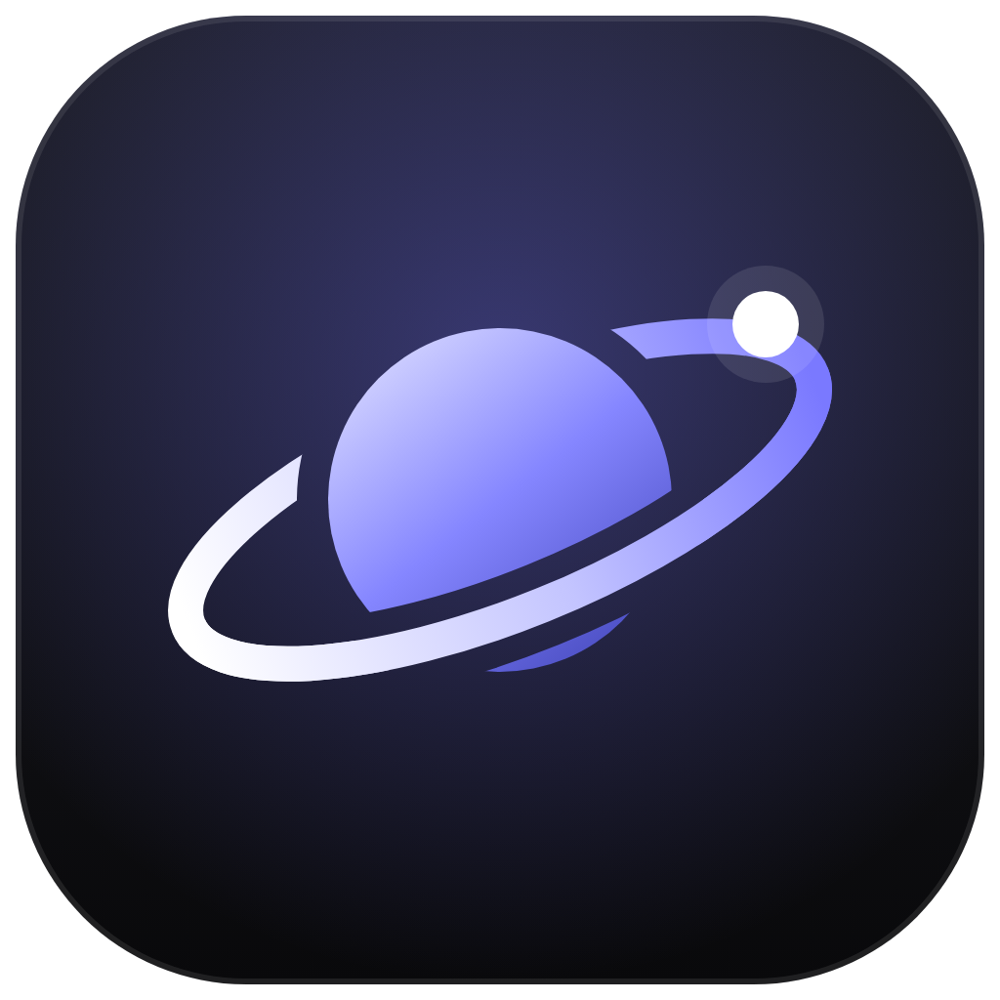
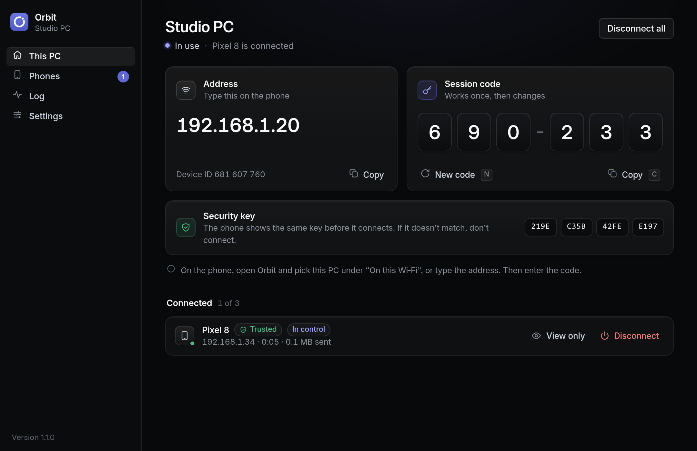
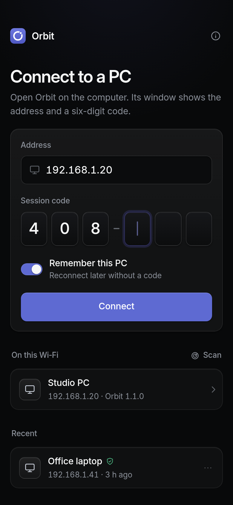
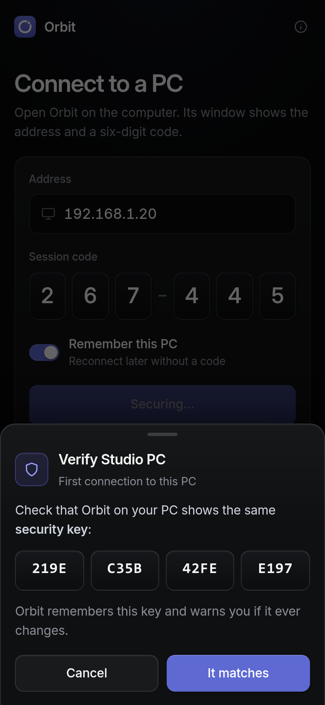
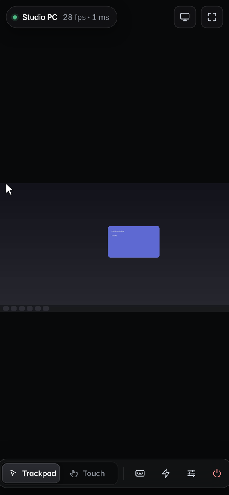

<div align="center">



# Orbit

Мышь и клавиатура для Windows-компьютера прямо с телефона.<br>
Работает по домашнему Wi-Fi, без аккаунтов и облака.

[Скачать для Windows](https://github.com/kabiriyer3-cmyk/orbit-remote/releases/latest/download/Orbit-Windows.exe) ·
[Скачать для Android](https://github.com/kabiriyer3-cmyk/orbit-remote/releases/latest/download/Orbit-Android.apk) ·
[Все версии](https://github.com/kabiriyer3-cmyk/orbit-remote/releases) ·
[English](#english)

</div>



Orbit состоит из двух частей. На компьютере запускается небольшая программа, которая показывает адрес и шестизначный код. На телефоне вы выбираете компьютер из списка, вводите код и видите экран ПК. Дальше телефон работает как тачпад: двигаете пальцем, и курсор ходит по экрану. Можно печатать с клавиатуры телефона, нажимать Ctrl, Alt, Win и готовые сочетания вроде Alt+Tab.

Удобно, когда компьютер подключён к телевизору, когда нужно поставить фильм на паузу с дивана или быстро что-то нажать, не подходя к столу.

## Что нужно

- Компьютер с Windows 10 или 11 (64-бит).
- Телефон на Android 7.0 или новее.
- Оба устройства в одной Wi-Fi сети. Через интернет Orbit напрямую не работает, об этом ниже.

## Установка на компьютер

1. Скачайте [Orbit-Windows.exe](https://github.com/kabiriyer3-cmyk/orbit-remote/releases/latest/download/Orbit-Windows.exe). Устанавливать ничего не нужно, это один файл. Его можно положить в любую папку, например в «Документы».
2. Запустите файл. Если появится синее окно «Система Windows защитила ваш компьютер», нажмите «Подробнее», затем «Выполнить в любом случае». Почему так происходит, написано [ниже](#почему-windows-и-android-предупреждают).
3. Брандмауэр Windows спросит, разрешить ли программе доступ к сети. Оставьте галочку «Частные сети» и нажмите «Разрешить доступ». Без этого телефон не увидит компьютер.

Откроется окно Orbit. Его можно закрыть крестиком: программа продолжит работать в трее, возле часов. Чтобы она запускалась сама после включения компьютера, откройте Settings и включите Start with Windows.

## Установка на телефон

1. Откройте на телефоне ссылку [Orbit-Android.apk](https://github.com/kabiriyer3-cmyk/orbit-remote/releases/latest/download/Orbit-Android.apk) и скачайте файл.
2. Нажмите на скачанный файл. Android попросит разрешить установку из этого источника (обычно из браузера или «Файлов»). Разрешите и вернитесь назад.
3. Нажмите «Установить». Если Play Защита скажет, что приложение ей незнакомо, нажмите «Всё равно установить» (иногда эта кнопка спрятана под «Подробнее»).

## Первое подключение

<table>
<tr>
<td width="33%"></td>
<td width="33%"></td>
<td width="33%"></td>
</tr>
</table>

1. Откройте Orbit на телефоне. Ваш компьютер появится в списке On this Wi-Fi. Если его там нет, впишите адрес из окна на компьютере в поле Address, например `192.168.1.20`.
2. Введите шестизначный код из карточки Session code на компьютере. Код одноразовый: после входа он меняется сам.
3. Телефон покажет ключ безопасности: четыре группы букв и цифр. Сравните их с карточкой Security key на компьютере. Если совпадают, подтверждайте.
4. На компьютере появится запрос. Нажмите Allow. Если отметить Trust this phone, в следующий раз код не понадобится.

Если на телефоне отметить Remember this PC, компьютер останется в списке Recent, и переподключаться можно будет одним нажатием.

## Как управлять

Внизу экрана есть переключатель Trackpad / Touch. В режиме Trackpad палец двигает курсор, как на тачпаде ноутбука. В режиме Touch вы нажимаете прямо туда, куда хотите кликнуть.

| Жест | Trackpad | Touch |
|---|---|---|
| Одно касание | Левый клик | Клик в это место |
| Касание двумя пальцами | Правый клик | Правый клик |
| Ведение пальцем | Двигает курсор | Перетаскивание |
| Нажать и подержать | Захватить и тащить | Правый клик |
| Два пальца вверх или вниз | Прокрутка | Прокрутка |
| Развести два пальца | Увеличить картинку | Увеличить картинку |
| Касание тремя пальцами | Открыть клавиатуру | Открыть клавиатуру |

На панели клавиатуры есть Ctrl, Alt, Shift и Win. Первое нажатие действует на одну следующую клавишу, второе фиксирует кнопку, третье отпускает. Там же стрелки, F1–F12, Alt+Tab, Win+D, копирование и вставка, Диспетчер задач и блокировка ПК. Качество картинки меняется кнопкой с ползунками: Speed для слабого Wi-Fi, Balanced по умолчанию, Sharp для мелкого текста.

## Звук с компьютера

Кнопка с динамиком вверху экрана включает звук компьютера на телефоне: музыку, видео, системные звуки, всё, что сейчас играет на ПК. Нажмите её ещё раз, чтобы выключить. Звук идёт по тому же зашифрованному каналу, что и картинка, и включается на каждом телефоне отдельно. Телефон запоминает выбор и при следующем подключении включает звук сам. Если звук не нужен совсем, выключите Share sound в настройках Orbit на компьютере. Если подключить наушники или сменить устройство вывода, Orbit переключится на него сам.

## Окна с правами администратора

Обычно Windows показывает запрос «Разрешить этому приложению вносить изменения?» на отдельном защищённом экране, который не видит ни одна программа, поэтому на телефоне в этот момент был чёрный экран. Включите в настройках Show admin prompts on the phone, и запрос будет появляться на обычном рабочем столе, а значит и на телефоне: вы увидите, какая программа просит права, вместо чёрного экрана.

- Для этого Orbit должен работать от имени администратора (кнопка Restart as admin). Если включить настройку раньше, она заработает после перезапуска с правами администратора.
- Windows по-прежнему спрашивает подтверждение на каждое действие с правами администратора, ничего не запускается само.
- Orbit меняет только настройки UAC `PromptOnSecureDesktop` и, если нужно, `ConsentPromptBehaviorAdmin`, и возвращает их как было, когда вы выключаете эту опцию или закрываете Orbit. Если Orbit закрылся аварийно, настройки вернутся при следующем запуске с правами администратора.
- Нажать «Да» в самом запросе с телефона пока нельзя. Windows запускает это окно с системными правами, выше, чем у любой программы администратора, и не пропускает в него нажатия от Orbit. Для этого Orbit нужна цифровая подпись и установка в Program Files (режим UIAccess) или отдельная системная служба, как у AnyDesk. Это запланировано на следующие версии.
- Защищённый экран нужен, чтобы другие программы на компьютере не могли подделать или подсмотреть этот запрос. Включайте опцию, только если вам действительно нужно видеть такие запросы с телефона.

## Почему Windows и Android предупреждают

Коротко: файлы не подписаны сертификатом, который стоит денег, и пока не опубликованы в Microsoft Store и Google Play. Вирусов в них нет, но проверить это можно и самостоятельно.

**Windows.** SmartScreen показывает предупреждение для любой программы, которую мало кто скачивал и которая не подписана платным сертификатом издателя. Сертификат стоит от 150 долларов в год, и даже с ним предупреждение исчезает не сразу, а когда у файла накопится «репутация». Поэтому предупреждение можно спокойно пропустить кнопками «Подробнее» и «Выполнить в любом случае». Версия для Microsoft Store готовится: оттуда программа будет ставиться без всяких окон.

Некоторые антивирусы ругаются на программы, собранные PyInstaller, просто по шаблону. Чтобы таких ложных срабатываний было меньше, загрузчик Orbit собирается из исходников на сервере GitHub при каждом релизе. Если антивирус всё-таки удалил файл, добавьте его в исключения или напишите в [Issues](https://github.com/kabiriyer3-cmyk/orbit-remote/issues), указав название антивируса.

**Android.** Любое приложение не из Google Play устанавливается только после разрешения «Установка из неизвестных источников». Это обычная защита Android, обойти её нельзя, да и не нужно. Play Защита иногда дополнительно спрашивает про незнакомое приложение; это тоже нормально.

**Как проверить, что файл настоящий.** Рядом с каждым файлом в [релизе](https://github.com/kabiriyer3-cmyk/orbit-remote/releases/latest) лежит `.sha256` с контрольной суммой. На компьютере откройте PowerShell в папке со скачанным файлом и выполните:

```powershell
Get-FileHash .\Orbit-Windows.exe -Algorithm SHA256
```

Число должно совпасть с тем, что записано в `Orbit-Windows.exe.sha256`. APK подписан ключом проекта, отпечаток SHA-256 сертификата:

```
12:1A:C6:CA:E8:35:6F:4B:FE:D6:E5:69:02:3B:8D:D2:11:1D:4E:71:FA:F2:6B:D0:23:01:18:23:ED:3D:5F:40
```

Android не даст поставить обновление поверх, если подпись другая, так что подменить уже установленное приложение не получится.

## Безопасность

Без кода и вашего подтверждения на компьютере никто не подключится. Код меняется после каждого входа, а после пяти неверных попыток адрес блокируется на минуту. Всё, что передаётся между телефоном и компьютером, зашифровано. Orbit ничего не отправляет в интернет и не собирает данные, подробности в [политике конфиденциальности](docs/privacy.md).

Если хочется только показывать экран, без управления, выключите Allow control в настройках. Доверенные телефоны видны в разделе Phones, там же их можно удалить кнопкой Remove.

<details>
<summary>Технические подробности</summary>

- Телефон подключается по TLS. Сертификат компьютера самоподписанный, но приложение запоминает отпечаток его открытого ключа (это и есть ключ безопасности на экране) и при следующих подключениях не пустит к другому ключу.
- Внутри TLS работает второй, сквозной канал: ECDH P-256, HKDF-SHA256, AES-256-GCM. Рукопожатие подписано ключом компьютера, и этот ключ обязан совпадать с ключом TLS.
- Код сессии не передаётся по сети. Телефон доказывает, что знает его, через HMAC, привязанный к конкретному рукопожатию.
- Доверенный телефон получает отдельный токен, который отзывается из раздела Phones.
- Окно на компьютере открывается только с `127.0.0.1` и защищено случайным токеном.

</details>

## Ограничения

- Только локальная сеть. Для управления через интернет поставьте на оба устройства VPN вроде Tailscale или ZeroTier и вводите адрес компьютера в этой сети.
- Windows не разрешает программам нажимать кнопки в окнах UAC («Разрешить этому приложению вносить изменения?»), на экране блокировки и после Ctrl+Alt+Del. Окно UAC можно сделать видимым на телефоне (см. «Окна с правами администратора»), но ответить на него пока нужно за компьютером.
- Окна, запущенные от администратора (Диспетчер задач, установщики), слушаются, только если Orbit тоже запущен от администратора. В Settings для этого есть кнопка Restart as admin.
- Звук передаётся только с компьютера на телефон, микрофон телефона не используется. Файлы не передаются. Версии для iPhone пока нет.

## Если не подключается

- Компьютер не появляется в списке. Проверьте, что телефон в той же сети, а не в гостевой и не на мобильном интернете. Попробуйте ввести адрес вручную.
- Адрес введён, но подключения нет. Скорее всего, мешает брандмауэр. Откройте Settings в Orbit и нажмите Add rule рядом с Windows Firewall. Если вы когда-то нажали «Отмена» в окне Windows о доступе к сети, это единственный способ вернуть доступ без копания в настройках.
- В некоторых роутерах включена «изоляция клиентов» (AP isolation): устройства в одной сети не видят друг друга. Её выключают в настройках роутера, обычно в разделе Wi-Fi. В гостевых сетях она почти всегда включена.
- Картинка тормозит. Переключите качество на Speed или подойдите ближе к роутеру. Сеть 5 ГГц работает заметно лучше 2,4 ГГц.
- Приложение пишет, что ключ компьютера изменился. Так бывает после переустановки Windows или удаления папки `%APPDATA%\OrbitRemote`. Если вы ничего такого не делали, не подключайтесь и проверьте сеть.

Не помогло? Опишите проблему в [Issues](https://github.com/kabiriyer3-cmyk/orbit-remote/issues).

## Для разработчиков

Компьютерная часть написана на Python (aiohttp, mss, SendInput, pywebview) и собирается в один `.exe` через PyInstaller. Интерфейс телефона лежит в `client/`: это обычный JavaScript без сборщика, который на Android работает внутри Capacitor вместе с небольшим нативным плагином для TLS и поиска в сети.

```powershell
cd host
pip install -r requirements.txt pyinstaller
python run_orbit.py                    # запуск из исходников
python run_orbit.py --selftest r.json  # самотест
pyinstaller orbit.spec --noconfirm     # dist\Orbit.exe
```

Флаг `--demo` показывает тестовую картинку вместо экрана и не нажимает реальные кнопки, поэтому так можно запускать и на Linux или macOS.

```bash
cd mobile
npm ci
npx cap sync android
cd android && ./gradlew assembleRelease
```

Для Android нужны Node 22, JDK 21 и Android SDK 36. GitHub Actions ([build.yml](.github/workflows/build.yml)) собирает оба файла на каждый push, а при теге `v*` публикует релиз. Там же собираются пакеты для магазинов: MSIX для Microsoft Store и AAB для Google Play. Как подписать сборки и выложить их в магазины, описано в [docs/publishing.md](docs/publishing.md).

Карта проекта, протокол и правила для правок (в том числе с помощью ИИ) собраны в [AGENTS.md](AGENTS.md).

Лицензия MIT.

---

## English

Orbit lets you use your Android phone as a mouse and keyboard for a Windows PC on the same Wi-Fi. You see the PC screen on the phone, move the pointer like on a laptop touchpad, type with the phone keyboard and send shortcuts such as Alt+Tab or Win+D. There are no accounts and nothing goes through the internet.

1. Download [Orbit-Windows.exe](https://github.com/kabiriyer3-cmyk/orbit-remote/releases/latest/download/Orbit-Windows.exe) and run it. It's a single portable file. If SmartScreen warns you, click "More info", then "Run anyway". When Windows asks about network access, allow private networks.
2. Install [Orbit-Android.apk](https://github.com/kabiriyer3-cmyk/orbit-remote/releases/latest/download/Orbit-Android.apk) on the phone and allow installs from that source.
3. Pick your PC under On this Wi-Fi, enter the six-digit code, check that the security key matches on both screens and click Allow on the PC.

The warnings appear because the files aren't signed with a paid code-signing certificate and the app isn't in the Microsoft Store or Google Play yet. Each release has `.sha256` files so you can check the downloads.

Tap the speaker button at the top of the session to hear the PC's sound on the phone; turn Share sound off on the PC to disable it entirely.

Windows draws UAC prompts ("Do you want to allow this app to make changes?") on a protected secure desktop that no app can see, so the phone used to show a black screen. With Orbit running as administrator, turn on Settings → Show admin prompts on the phone and the prompt appears in the stream. Orbit changes only the UAC policies `PromptOnSecureDesktop` (and `ConsentPromptBehaviorAdmin` when needed) and puts them back when you turn the option off or quit. Clicking Yes from the phone isn't possible yet: the prompt runs above administrator level and needs a signed UIAccess build or a system service.

Orbit works only on the local network; use a VPN such as Tailscale to reach your PC from elsewhere. Windows doesn't let any app click on UAC prompts or the lock screen. File transfer isn't supported.
