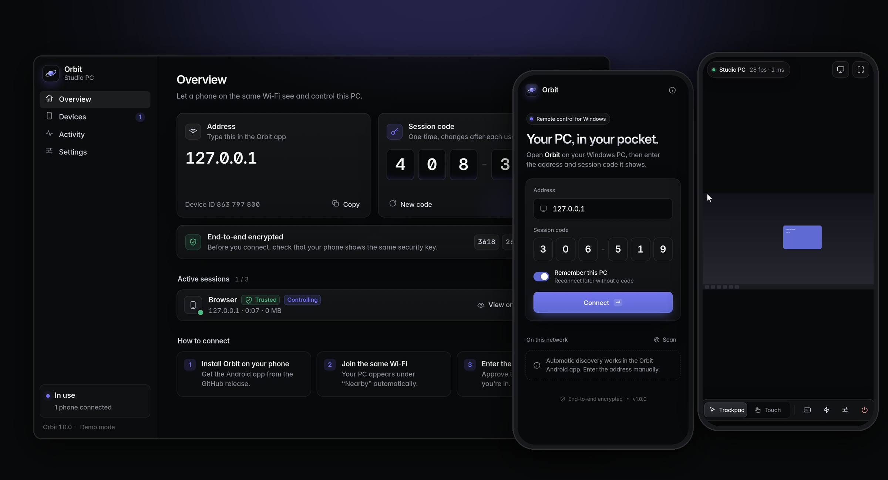

<div align="center">


# Orbit

**Управляйте Windows‑ПК с телефона — курсор, клавиатура, жесты.**
Open‑source аналог AnyDesk для локальной сети: приложение для ПК + Android‑приложение.

[](https://github.com/kabiriyer3-cmyk/orbit-remote/actions/workflows/build.yml)
[](https://github.com/kabiriyer3-cmyk/orbit-remote/releases/latest)
[](LICENSE)

[**Скачать для Windows**](https://github.com/kabiriyer3-cmyk/orbit-remote/releases/latest/download/Orbit-Windows.exe) ·
[**Скачать для Android**](https://github.com/kabiriyer3-cmyk/orbit-remote/releases/latest/download/Orbit-Android.apk) ·
[English](#english)



</div>

## Возможности

- **Экран ПК на телефоне** — живая картинка до 60 FPS, выбор монитора, качество «Скорость / Баланс / Чётко».
- **Мышь** — режимы *Трекпад* (как тачпад ноутбука) и *Касание* (тап = клик в точку), перетаскивание, правый клик, прокрутка, зум картинки.
- **Клавиатура** — системная клавиатура телефона с поддержкой любого языка, панель Ctrl / Alt / Shift / Win (одно нажатие или фиксация), стрелки, F1–F12, готовые сочетания (Alt+Tab, Win+D, Ctrl+C/V, Диспетчер задач…), вставка текста, блокировка ПК.
- **Безопасность** — TLS с привязкой к ключу ПК + отдельный сквозной шифрованный канал, одноразовый код сессии, подтверждение на ПК, доверенные устройства, защита от перебора.
- **Автопоиск** — ПК в той же Wi‑Fi сети появляются в приложении сами.
- **Панель на ПК в стиле Linear** — адрес, код, активные сессии, режим «только просмотр», журнал событий, настройки, автозапуск, правило брандмауэра.

## Быстрый старт

1. Скачайте **[Orbit-Windows.exe](https://github.com/kabiriyer3-cmyk/orbit-remote/releases/latest/download/Orbit-Windows.exe)** и запустите (установка не нужна). При первом запуске Windows может спросить про доступ к сети — разрешите для *частных сетей*. Если SmartScreen предупредит о неизвестном издателе — «Подробнее → Выполнить в любом случае».
2. Установите **[Orbit-Android.apk](https://github.com/kabiriyer3-cmyk/orbit-remote/releases/latest/download/Orbit-Android.apk)** на телефон (разрешите установку из этого источника).
3. Подключите телефон к той же Wi‑Fi сети, выберите ПК в списке «В этой сети» (или введите адрес), введите 6‑значный код.
4. Сверьте **ключ безопасности** на обоих экранах, подтвердите запрос на ПК — готово.

<table>
<tr>
<td width="33%"></td>
<td width="33%"></td>
<td width="33%"></td>
</tr>
</table>

## Жесты

| Жест | Трекпад | Касание |
|---|---|---|
| Тап | Левый клик | Клик в точку касания |
| Тап двумя пальцами | Правый клик | Правый клик |
| Движение пальцем | Двигает курсор (с ускорением) | Перетаскивание, как на сенсорном экране |
| Нажать и удерживать | Захват для перетаскивания | Правый клик |
| Два пальца — вверх/вниз | Прокрутка | Прокрутка |
| Щипок | Масштаб картинки | Масштаб картинки |
| Тап тремя пальцами | Клавиатура | Клавиатура |

## Как это устроено

```
┌──────────── Телефон (Android) ────────────┐          ┌──────────── Windows ПК ─────────────┐
│ Web UI (HTML/CSS/JS, Capacitor WebView)   │          │ Orbit.exe (Python, PyInstaller)      │
│  • рендер кадров на canvas, жесты, ввод   │          │  • захват экрана (mss) → JPEG        │
│  • WebCrypto: ECDH, ECDSA, AES‑GCM        │          │  • ввод через SendInput (Win32)      │
│ Нативный плагин OrbitNative (Java)        │  TLS     │  • aiohttp: wss://:47800             │
│  • TLS‑туннель с пиннингом ключа  ────────┼─────────►│  • UDP‑автопоиск :47801              │
│  • UDP‑поиск, wake‑lock, immersive        │  Wi‑Fi   │  • панель управления (pywebview)     │
└───────────────────────────────────────────┘          └──────────────────────────────────────┘
```

| Папка | Что внутри |
|---|---|
| `host/` | Приложение для ПК: сервер, захват, ввод, панель управления (`orbit_host/web`), самотест, PyInstaller‑спека |
| `client/` | Интерфейс телефона (чистый JS‑модульный код без сборщика) |
| `mobile/` | Android‑оболочка на Capacitor 8 + нативный плагин `OrbitNative` |
| `.github/workflows/build.yml` | CI: сборка `.exe` и `.apk`, самотесты, публикация релиза |

## Модель безопасности

- **Транспорт.** Телефон подключается к ПК по TLS 1.2+/1.3. Сертификат ПК самоподписанный, но содержит его постоянный ключ идентичности (ECDSA P‑256); приложение **пиннингует SHA‑256 открытого ключа** — тот самый «ключ безопасности», который показан на обоих экранах. Первое подключение — TOFU с ручной сверкой ключа, дальше любой другой ключ блокируется с предупреждением.
- **Сквозное шифрование внутри TLS.** Эфемерный ECDH P‑256 → HKDF‑SHA256 → AES‑256‑GCM со строго возрастающими nonce, транскрипт подписан ключом ПК. Ключ TLS и ключ канала обязаны совпадать.
- **Авторизация.** Одноразовый 6‑значный код (меняется после каждого использования) никогда не передаётся — телефон доказывает знание кода через HMAC, привязанный к конкретному рукопожатию. Новое подключение по умолчанию требует подтверждения на ПК; доверенные телефоны получают отдельный токен, который можно отозвать.
- **Защита от перебора.** 5 неверных кодов → блокировка адреса на минуту и смена кода.
- **Локальная панель** доступна только с `127.0.0.1` и защищена случайным токеном.
- В Android‑приложении открытый трафик запрещён везде, кроме loopback (`127.0.0.1`), — по нему WebView общается с нативным TLS‑туннелем внутри телефона.

## Ограничения

- **Только локальная сеть.** Для доступа через интернет используйте VPN‑сеть (Tailscale, ZeroTier, WireGuard) и вводите адрес ПК в ней.
- **UAC и экран блокировки.** Windows не даёт программам управлять «защищённым рабочим столом» (окна UAC, Ctrl+Alt+Del, экран входа). Чтобы управлять окнами, запущенными от администратора (Диспетчер задач, установщики), перезапустите Orbit от администратора — кнопка есть в настройках.
- Нет передачи звука и файлов; версия для iOS не собирается (интерфейс телефона — веб‑код, его можно обернуть и для iOS).
- `.exe` не подписан сертификатом издателя — SmartScreen может показать предупреждение.

## Сборка из исходников

**ПК (Windows, Python 3.12):**

```powershell
cd host
pip install -r requirements.txt pyinstaller
python run_orbit.py                 # запуск из исходников
python run_orbit.py --selftest r.json   # самотест: захват, ввод, протокол, TLS‑пиннинг, подтверждение
pyinstaller orbit.spec --noconfirm  # → dist\Orbit.exe
```

Полезные флаги: `--headless`, `--demo` (синтетический экран, без реального ввода — работает и на Linux/macOS), `--port`, `--minimized`, `--data-dir`.

**Android (Node 22, JDK 21, Android SDK 36):**

```bash
cd mobile
npm ci
npx cap sync android
cd android && ./gradlew assembleRelease
```

## CI и релизы

Workflow [`build.yml`](.github/workflows/build.yml) на каждый push собирает `Orbit-Windows.exe` (с самотестом исходников и готового `.exe` на `windows-latest`) и подписанный `Orbit-Android.apk`. При push тега `v*` создаётся GitHub Release с обоими файлами и SHA‑256.

Секреты для подписи APK: `ANDROID_KEYSTORE_BASE64`, `ANDROID_KEYSTORE_PASSWORD`, `ANDROID_KEY_ALIAS`, `ANDROID_KEY_PASSWORD`. Без них APK подписывается отладочным ключом.

```bash
git tag v1.0.1 && git push origin v1.0.1   # новый релиз
```

---

## English

**Orbit** turns your Android phone into a remote control for your Windows PC over the local network — live screen, trackpad & touch mouse modes, full keyboard with modifier keys and shortcuts.

- **Download:** [Orbit-Windows.exe](https://github.com/kabiriyer3-cmyk/orbit-remote/releases/latest/download/Orbit-Windows.exe) · [Orbit-Android.apk](https://github.com/kabiriyer3-cmyk/orbit-remote/releases/latest/download/Orbit-Android.apk)
- **Security:** TLS pinned to the PC's identity key (the fingerprint shown on both screens) wrapping an end‑to‑end encrypted channel (ECDH P‑256, HKDF‑SHA256, AES‑256‑GCM). One‑time session codes proven via HMAC, approval on the PC, revocable trusted devices, brute‑force lockout.
- **Stack:** Python host (aiohttp, mss, SendInput, pywebview) packaged with PyInstaller; web client in vanilla JS inside a Capacitor 8 Android shell with a small native plugin (pinned TLS tunnel, UDP discovery).
- **Limits:** LAN only (use a VPN such as Tailscale for remote access); Windows' secure desktop (UAC prompts, Ctrl+Alt+Del, sign‑in screen) can't be controlled; no audio or file transfer.

MIT © Orbit Remote contributors
